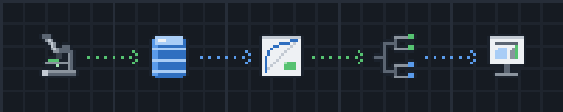
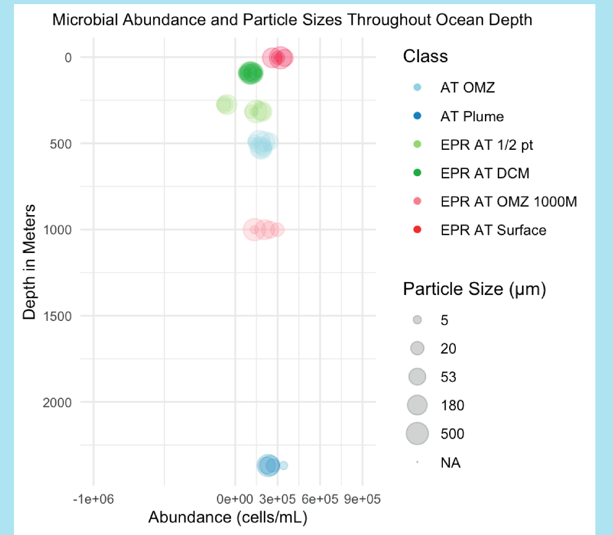

# Matthew Thompson: Biology + Data Science Portfolio

> **Data Analyst** · M.S. Data Science, University of Arizona (May 2026) · B.S. Biology, Gallaudet University · SQL · Python · R · [See full bio](https://github.com/matthewqilanthompson)

I clean, validate and analyze research and health data. Before data science I spent two research internships counting, measuring and modeling biological data, and I found I enjoyed the data side most.

**Navigation**: [Start here](#-start-here) • [Health data](#-health-data) • [Biology research](#-biology-research) • [Methods](#-methods-projects) • [Skills](#-skills) • [Connect](#-connect)

##  Start here

| If you have one minute | What it shows |
|---|---|
| [**Readmission model: catching a data leak**](#healthcare-readmission-prediction) | An early model scored a perfect 1.0. I treated that as a bug, found the leaked target data, and re-validated to ROC AUC 0.858 on a held-out test |
| [**Healthcare SQL database**](#healthcare-analytics-with-sql) | An 8-table database built from synthetic health records, with 6 documented SQL reports and a documented data-quality check |
| [**REU poster: microbes on marine snow**](#microbial-abundance-on-marine-snow-nsf-reu) | Lab counts from 63 sample tubes, analyzed in R, and a result that did not match a published study |

Each project below follows the same order: the question, the data, what I did, the result and its limits.

---

##  Health data

### Healthcare Readmission Prediction

**Question:** which hospital encounters will lead to a readmission within 30 days? · _Graduate project, INFO 511 class competition · University of Arizona_

**Data:** synthetic electronic health record (EHR) data generated with Synthea: 587,801 training encounters and 125,958 dev encounters.

**What I did:** compared 9 algorithms with stratified 5-fold cross-validation and built a Random Forest with patient-frequency encoding. Missing medication counts, procedure costs, pain scores and height were mean-imputed, and `class_weight='balanced'` handled the uneven target.

**The leak:** an early version scored a perfect 1.0. Instead of taking the win, I went looking for the mistake: a feature aggregated the target column by patient. I removed it and re-validated until the number was real.

**Why Random Forest:** HistGradientBoosting scored highest in cross-validation (ROC AUC 0.862), with Random Forest close behind (0.841) and the smallest fold-to-fold spread (±0.0015). I chose Random Forest for its simplicity and stability.

**Result:** ROC AUC 0.858 on the final held-out test (0.901 in the dev phase). ROC AUC is a ranking score where 1.0 is perfect, so 0.858 means the model ranks a readmitted encounter above a non-readmitted one about 86% of the time. The tuned model's cross-validated score (0.859) predicted the test result almost exactly.

**Limits:** the data is synthetic, so the model says nothing about real patients; it shows the workflow.

**Tech**: Python • Scikit-learn • Pandas • Random Forest • Stratified Cross-Validation · [Read the project →](./projects/data-science/foundation-of-data-science/)

**See the work**: [Main analysis notebook](./projects/data-science/foundation-of-data-science/final_project_process.ipynb) · [Browser-readable version](./projects/data-science/foundation-of-data-science/final_project_process.md) · [Training + prediction CLI](./projects/data-science/foundation-of-data-science/train_predict.py)

---

### Healthcare Analytics with SQL

**Question:** which providers are overloaded, which patients come back most, and where is care riskiest? · _Graduate project, INFO 579 · University of Arizona_

**Data:** a ~65MB Synthea synthetic EHR dataset: 1,171 patients and 53,346 encounters from 6 source files.

**What I did:** designed an 8-table Third Normal Form (3NF) schema, loaded it with a Python loader, checked the table relationships in pandas, and wrote 6 documented analytical reports against 5 business objectives: profitability, clinical quality, provider utilization, readmission reduction, and strategic expansion. The reports use multi-table joins, common table expressions, correlated subqueries and temporal analysis (DATE_ADD, TIMESTAMPDIFF). The whole project reproduces with one Docker command.

**Data quality:** a LEFT JOIN check against `encounter` found that 10.13% of observation rows had no encounter ID recorded. Those rows load as explicit NULLs, and the rate is documented so encounter-level reporting accounts for the gap.

**Result (on synthetic data):** the reports surfaced the kind of findings an operations team would act on. Provider workload was badly imbalanced (the busiest provider handled 3,000+ encounters while peers stayed under 2,000), and a cohort of high-risk, frequent emergency patients was flagged for follow-up. Viral sinusitis appeared in 63% of patients, and 30-day mortality per 1,000 encounters was highest for inpatient (39.7) and emergency (27.3) care.

<table>
<tr>
<td width="50%" valign="top"> The 8 base tables and their foreign-key relationships</td>
<td width="50%" valign="top"> Top 10 providers by encounter count</td>
</tr>
</table>

**Tech**: MySQL • SQL (joins, CTEs, correlated subqueries, temporal analysis) • 3NF schema design • Python / pandas (validation) • Docker · [Read the project →](./projects/database-systems/sql-nosql-databases-info579/)

**See the work**: [Full report (PDF)](./projects/database-systems/sql-nosql-databases-info579/reports/INFO579-Final-Project-Report-Thompson.pdf) · [Schema (SQL)](./projects/database-systems/sql-nosql-databases-info579/sql/00_schema.sql) · [The 6 analytical reports (SQL)](./projects/database-systems/sql-nosql-databases-info579/sql/analytical_reports/)

---

##  Biology research

### Microbial Abundance on Marine Snow (NSF REU)

**Question:** do bacteria on sinking ocean particles ("marine snow") become scarcer with depth, and do smaller particles carry more of them? · _NSF REU, Maryland Sea Grant (Horn Point Laboratory), summer 2022; extended into an Honors thesis at Gallaudet University_

**Data:** stored samples from a 2019 East Pacific Rise research cruise, from 4 m to 2,369 m deep.

**What I did:** processed and counted 63 sample tubes with DAPI staining and epifluorescence microscopy, then managed and analyzed the counts in R and Excel.

**Result:** no correlation between particle size and abundance. Abundance fell until about 300 m and then rose again in deep water, which did not match a published study (Bergauer et al. 2018); I named possible reagent contamination as one explanation.

 Bacterial abundance by depth, from the poster

**Tech**: R • Excel • epifluorescence microscopy · [Read the project →](./projects/research/reu-marine-snow/) · [Poster (PDF)](./projects/research/reu-marine-snow/REU-Marine-Snow-Poster-Thompson.pdf)

---

### Temperature, Color and Behavior in Grasshoppers (NSF ON-RaMP)

**Question:** does the temperature a grasshopper grows up in change its adult coloration and behavior? · _Post-baccalaureate research, Oklahoma State University, 2023-2024 · Poster at the 2024 Society for Integrative and Comparative Biology (SICB) Conference, with Michael Reichert_

**What I did:** ran a temperature experiment on *Syrbula admirabilis* (juveniles reared at 28°C vs. 34°C), quantifying body color with photo analysis and spectrophotometry and measuring repeated behavior trials. Extracted, cleaned, and validated 174 raw spectral files in R with the `pavo` package (300–700 nm), built the statistical models in R (regression, analysis of variance, repeatability), and wrote a Python script that automated a recurring data-prep task.

**Status:** the poster presented interim results while the study was still in progress; the final analysis is in a co-authored manuscript, currently under peer review, so the data is not posted here.

---

### Trait-Based Prediction of Animal Taxa

**Question:** which encoding of animal traits better predicts an animal's higher-level group: whether a trait is present, or how fast it evolved? · _Graduate project, INFO 523 (Data Mining & Machine Learning) · University of Arizona_

**Data:** binary trait presence/absence for 1,087 animal families, and 84 phylum-level estimates of evolutionary origin rates, across 5 superphyla (Ecdysozoa, Lophotrochozoa, Deuterostomia, Basal Metazoa, Basal Bilateria).

**What I did:** compared Logistic Regression, Decision Tree and Random Forest on each encoding, used balanced metrics for the class imbalance (Arthropoda is ~84% of the binary data), and used SHAP (SHapley Additive exPlanations) to see which traits drove each model.

**Result:** the best rate-data model (Logistic Regression) reached macro F1 0.31 and balanced accuracy 0.32 on the 5-class taxonomy (chance ≈ 0.20), against macro F1 0.09-0.13 for every binary-data model (on a different, larger test set). Random Forest on the rate data tied on balanced accuracy (0.32) with a lower macro F1 (0.23).

**Limits:** this is limited signal. The rate-data test set had only 28 rows, and a random-forest 5-fold cross-validation on the same data scored macro F1 0.19, near chance.

 SHAP on evolutionary-rate data: Visual (V), Competition (C), Auditory (A) strongest

**Tech**: Python • Scikit-learn • SHAP • Stratified K-fold cross-validation · [Read the project →](./projects/data-science/data-mining-final-project/)

**See the work**: [Live project website](https://info-523-su25.github.io/final-project-thompson/) · [Analysis notebook](./projects/data-science/data-mining-final-project/index.ipynb)

---

##  Methods projects

### Multi-Label Emotion Classification (CNN, plus a RoBERTa follow-up study)

**Question:** can a model tag Reddit comments with 14 emotions at once? · _Graduate project, INFO 557 class competition · University of Arizona_

**What I did:** built a 5-seed ensemble of 1D convolutional neural networks (Conv1D / CNN) on a 14-class GoEmotions subset, with binary cross-entropy loss, label smoothing and a fixed 0.5 threshold instead of one tuned on dev data. Kernel size 3 won the dev sweep over 5 and 7, since emotion cues sit in short word sequences.

**Result:** F1 0.672 on the test set. Re-scoring the saved model on the labeled dev data gave 0.65, so the test score held up; the training logs had shown 0.72, which over-predicted the test. I now trust a re-scored checkpoint over training logs. F1 is a balanced precision/recall metric where 1.0 is perfect.

**Limits and the follow-up:** the submitted model never got the rare classes off the floor. Even 5x duplication of the rarest examples only lifted anger to F1 0.154 on test, while annoyance and disapproval stayed at zero. After grading, I ran a 4-variant study that was never submitted (the course limited entries to taught techniques): end-to-end fine-tuning of RoBERTa started predicting those classes and reached about 0.83 dev F1.

**Tech**: Python • Keras / TensorFlow • Conv1D CNN • 5-seed ensemble • RoBERTa fine-tuning (follow-up study) · [Read the project →](./projects/deep-learning/emotion-classification-info557/)

**See the work**: [Submitted model: training pipeline](./projects/deep-learning/emotion-classification-info557/train_dev.py) · [EDA notebook](./projects/deep-learning/emotion-classification-info557/eda.ipynb) · [Post-grading experiments](./projects/deep-learning/emotion-classification-info557/experiments/)

---

### Other projects

| Project | What it shows | Tech |
|---|---|---|
| [**Data Visualization Portfolio**](./projects/r-analytics/data-visualization-portfolio/) | Wildlife predation, occupational safety, and housing economics analyses with chart-selection rationale (alluvial diagrams, line graphs, grouped bars) | R · ggplot2 · ggalluvial · RMarkdown |
| [**AI4HC Capstone: Rural Health Kiosk Showcase Poster**](./projects/capstone/ai4hc-info698/) | Light/dark theme HTML poster and Python print-export pipeline (headless Chrome → 48×36 in PDF) for a team capstone at the University of Arizona AI Core | HTML · CSS · Python |

<table>
<tr>
<td width="50%" valign="top"> Figure 3: top 5 most dangerous occupations: trends + cause-of-fatality flows <a href="./projects/r-analytics/data-visualization-portfolio/reports/MatthewThompson_Final_Portfolio.pdf">Complete portfolio (PDF)</a> · <a href="./projects/r-analytics/data-visualization-portfolio/Final-Portfolio-Assignment.Rmd">R Markdown source</a></td>
<td width="50%" valign="top"> System architecture diagram from the team's showcase poster <a href="./projects/capstone/ai4hc-info698/iShowcase_Final.pdf">Final showcase poster (PDF)</a></td>
</tr>
</table>

---

##  Skills

| Category             | Tools & Libraries                                                                                                                   |
| -------------------- | ----------------------------------------------------------------------------------------------------------------------------------- |
| **SQL & Databases**  | SQL / Structured Query Language (multi-table joins, aggregations, temporal analysis) • MySQL • Database design (Third Normal Form / 3NF) • Common Table Expressions (CTEs) • Correlated subqueries • ETL |
| **Data Quality**     | Data validation & reconciliation • integrity checks (unlinked-record detection) • data-leakage detection • cross-validation |
| **Languages**        | SQL • Python (machine-learning pipelines, data processing) • R (statistical analysis, visualization) |
| **Data Analysis**    | Pandas (data manipulation, wrangling and preparation) • NumPy (numerical computing) • tidyverse (data transformation) • dplyr (data wrangling) • Excel (research use) |
| **Visualization & Reporting** | ggplot2 (statistical plots) • Matplotlib • ggalluvial (flow diagrams) • viridis (color palettes) • analytical report writing |
| **Statistics**       | Linear regression • ANOVA • hypothesis testing • experimental design • repeatability analysis |
| **Machine Learning** | Scikit-learn (model training, evaluation) • Random Forest (classification) • Logistic Regression • SHAP / SHapley Additive exPlanations (model explainability) |
| **Deep Learning**    | Keras / TensorFlow (neural network architecture) • Hugging Face Transformers • RoBERTa fine-tuning • Convolutional neural networks (CNNs) • Multi-label classification |
| **Lab & Research**   | Spectral data processing in R (`pavo`) • DAPI staining and epifluorescence microscopy • scientific posters |
| **Development**      | Git (version control) • Docker • Jupyter (interactive analysis) • RMarkdown (reproducible reports) • Quarto (publishing workflows) |

---

##  Connect

