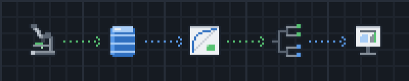

# Matthew Thompson - Data Science Portfolio

> **M.S. Data Science** · University of Arizona (May 2026) · B.S. Biology · [See full bio](https://github.com/matthewqilanthompson)

---

**Highlights**

- **Healthcare SQL**: Third Normal Form (3NF) database design and 6 analytical SQL reports across **53,346 patient encounters**. The reports surfaced a provider workload imbalance and a high-risk patient cohort.
- **Readmission model**: a Random Forest predicting 30-day hospital readmission at **ROC AUC 0.858** on the final held-out test, trained on 587,801 rows of synthetic electronic health record (EHR) data. ROC AUC is a ranking score where 1.0 is perfect, so 0.858 means the model ranks a high-risk patient above a low-risk one about 86% of the time.

**Navigation**: [Projects](#featured-projects) • [Skills](#skills) • [Connect](#connect)

##  Featured Projects

Each project below documents a deliberate model-selection decision and the outcome it produced. Full methodology, code, and reproducibility details live in each project's own README.

###  [Healthcare Analytics with SQL](./projects/database-systems/sql-nosql-databases-info579/)

**Relational database design and analytical reporting on 53,346 patient encounters** · _Graduate project · University of Arizona_

Designed an 8-table Third Normal Form (3NF) schema, built from 6 source files, for 1,171 patients and 53,346 encounters from a ~65MB Synthea synthetic electronic health record (EHR) dataset, then wrote 6 documented analytical reports against 5 business objectives: profitability, clinical quality, provider utilization, readmission reduction, and strategic expansion. End-to-end reproducible via Docker.

**Why 3NF, and why SQL over pandas**: the source EHR data arrived denormalized, with patient, provider, encounter, and condition attributes repeated across rows, which makes update anomalies inevitable and analytical queries slow. Normalizing to 3NF eliminated the redundancy and let each business question be answered by a query against the schema rather than a bespoke script. The reporting logic lives in SQL (multi-table joins, common table expressions, correlated subqueries, temporal analysis with DATE_ADD and TIMESTAMPDIFF) because it belongs next to the data, stays reproducible, and can be handed to anyone who reads SQL.

**Outcome**: the reports surfaced findings an operations team could act on. Provider workload was badly imbalanced (the busiest provider handled 3,000+ encounters while peers stayed under 2,000), and a cohort of high-risk, high-frequency emergency patients was flagged for follow-up. Clinical-quality reporting found viral sinusitis in 63% of patients, and a 30-day mortality rate per 1,000 encounters put inpatient (39.7) and emergency (27.3) care at the top. A LEFT JOIN check against `encounter` found that 10.13% of observation rows had no encounter ID recorded; those rows load as explicit NULLs, and the rate is documented so encounter-level reporting accounts for the gap.

<table>
<tr>
<td width="50%" valign="top"> The 8 base tables and their foreign-key relationships</td>
<td width="50%" valign="top"> Top 10 providers by encounter count</td>
</tr>
</table>

**Tech**: MySQL • SQL (joins, CTEs, correlated subqueries, temporal analysis) • 3NF schema design • Python / pandas (validation) • Docker · [Read the project →](./projects/database-systems/sql-nosql-databases-info579/)

**See the work**: [Full report (PDF)](./projects/database-systems/sql-nosql-databases-info579/reports/INFO579-Final-Project-Report-Thompson.pdf) · [Schema (SQL)](./projects/database-systems/sql-nosql-databases-info579/sql/00_schema.sql) · [The 6 analytical reports (SQL)](./projects/database-systems/sql-nosql-databases-info579/sql/analytical_reports/)

---

###  [Healthcare Readmission Prediction Competition](./projects/data-science/foundation-of-data-science/)

**30-day hospital readmission prediction** · _Graduate project · University of Arizona_

Random Forest classifier with patient-frequency encoding on synthetic electronic health record (EHR) data: 587,801 training encounters and 125,958 dev encounters.

It scored ROC AUC 0.901 in the dev phase and 0.858 on the final held-out test, after comparing 9 algorithms with stratified cross-validation.

**Why Random Forest**: EHR data is tabular, mixes numeric and categorical features, has missing medication counts, and is class-imbalanced. Random Forest handles all of that natively.

It also surfaces feature importance, and it proved more stable across cross-validation folds than Gradient Boosting did.

**Outcome**: ROC AUC 0.858 on the held-out test means the model ranks a high-risk patient above a low-risk one about 86% of the time.

The score dropped from 0.901 in the dev phase to 0.858 on the test. That drop is honest generalization rather than a failure: the cross-validated estimate predicted the test result almost exactly, so the model held up on data it had never seen.

**Tech**: Python • Scikit-learn • Pandas • Random Forest • Stratified Cross-Validation · [Read the project →](./projects/data-science/foundation-of-data-science/)

**See the work**: [Main analysis notebook](./projects/data-science/foundation-of-data-science/final_project_process.ipynb) · [Browser-readable version](./projects/data-science/foundation-of-data-science/final_project_process.md) · [Training + prediction CLI](./projects/data-science/foundation-of-data-science/train_predict.py)

---

###  [Multi-Label Emotion Classification with Transformer Fine-Tuning](./projects/deep-learning/emotion-classification-info557/)

**14-label text classification competition** · _Graduate project · University of Arizona_

Scored F1 0.672 on the test set, with a dev-to-test gap of only -0.05. F1 is a balanced precision/recall metric where 1.0 is perfect.

Built a 5-seed 1D convolutional neural network (Conv1D / CNN) on a 14-class GoEmotions subset of Reddit text, with calibrated binary cross-entropy (BCE) loss and label smoothing.

**Why Conv1D, then RoBERTa fine-tuning in the post-grading study**: Reddit emotion cues live in bigrams and trigrams, which Conv1D with kernel size 3 captures cleanly (kernel 3 won the dev sweep over 5 and 7). The submitted Conv1D scored 0.65 dev F1. A follow-up 4-variant study, run after grading and never submitted (the course restricted entries to taught techniques), showed end-to-end fine-tuning of RoBERTa, not pretraining or model size alone, was the lever that reached 0.83 dev F1.

**Outcome**: the submitted model held its score from dev to test, with a gap of only -0.05. That is what calibration-aware training buys, and it matters more than chasing a dev score.

It never got the rare classes off the floor, though. Even 5x duplication of the rarest examples only nudged anger to F1 0.154 on test, while annoyance and disapproval stayed at zero.

The post-grading study showed that was a representation problem rather than an architecture one. End-to-end RoBERTa fine-tuning started predicting the classes the submitted model left at zero, and lifted dev F1 to about 0.83.

**Tech**: Python • Keras / TensorFlow • Conv1D CNN • 5-seed ensemble • 5x rare-class duplication • RoBERTa fine-tuning (post-grading study) · [Read the project →](./projects/deep-learning/emotion-classification-info557/)

**See the work**: [Submitted model: training pipeline](./projects/deep-learning/emotion-classification-info557/train_dev.py) · [EDA notebook](./projects/deep-learning/emotion-classification-info557/eda.ipynb) · [Post-grading experiments](./projects/deep-learning/emotion-classification-info557/experiments/)

---

###  [Trait-Based Prediction of Animal Taxa](./projects/data-science/data-mining-final-project/)

**Machine-learning classification of animal taxa from evolutionary traits (1,087 families; 84 phylum-level rate estimates)** · _Graduate project · University of Arizona_

Classification across 5 superphyla (Ecdysozoa, Lophotrochozoa, Deuterostomia, Basal Metazoa, Basal Bilateria) comparing binary trait presence/absence vs. continuous evolutionary origin rates. The headline finding: the best model on evolutionary-rate features outperformed every model on binary presence/absence. Used SHAP (SHapley Additive exPlanations) for feature importance and balanced metrics to handle class imbalance.

**Why Logistic Regression over Random Forest and Decision Trees**: Evolutionary-rate features were continuous and approximately linear with respect to taxonomic class, which Logistic Regression's decision boundary fits well. With only 84 phylum-level rate estimates and class imbalance across 5 superphyla, Logistic Regression's calibrated probabilities and interpretable per-trait coefficients gave stronger signal than tree-based models, which over-fit on sparse rare-class samples.

**Outcome**: the best model (Logistic Regression on evolutionary-rate data) reached macro F1 0.31 and balanced accuracy 0.32 on the 5-class taxonomy (chance ≈ 0.20), versus macro F1 ~0.13 on the binary data. That is limited signal: the rate-data test set had only 28 rows, and a random-forest 5-fold cross-validation on the same data scored macro F1 0.19, near chance. The best rate-data model still outperformed every binary-data model.

 SHAP on evolutionary-rate data: Visual (V), Competition (C), Auditory (A) strongest

**Tech**: Python • Scikit-learn • SHAP • Stratified K-fold cross-validation · [Read the project →](./projects/data-science/data-mining-final-project/)

**See the work**: [Live project website](https://info-523-su25.github.io/final-project-thompson/) · [Analysis notebook](./projects/data-science/data-mining-final-project/index.ipynb)

---

##  Other Projects

| Project | What it shows | Tech |
|---|---|---|
| [**Data Visualization Portfolio**](./projects/r-analytics/data-visualization-portfolio/) | Wildlife predation, occupational safety, and housing economics analyses with chart-selection rationale (alluvial diagrams, line graphs, grouped bars) | R · ggplot2 · ggalluvial · RMarkdown |
| [**AI4HC Capstone: Rural Health Kiosk Showcase Poster**](./projects/capstone/ai4hc-info698/) | Light/dark theme HTML poster and Python print-export pipeline (headless Chrome → 48×36 in PDF) for a team capstone at the University of Arizona AI Core | HTML · CSS · Python |

<table>
<tr>
<td width="50%" valign="top"> Figure 3: top 5 most dangerous occupations: trends + cause-of-fatality flows <a href="./projects/r-analytics/data-visualization-portfolio/reports/MatthewThompson_Final_Portfolio.pdf">Complete portfolio (PDF)</a> · <a href="./projects/r-analytics/data-visualization-portfolio/Final-Portfolio-Assignment.Rmd">R Markdown source</a></td>
<td width="50%" valign="top"> System architecture diagram from the team's showcase poster <a href="./projects/capstone/ai4hc-info698/iShowcase_Final.pdf">Final showcase poster (PDF)</a></td>
</tr>
</table>

---

##  Skills

| Category             | Tools & Libraries                                                                                                                   |
| -------------------- | ----------------------------------------------------------------------------------------------------------------------------------- |
| **SQL & Databases**  | SQL / Structured Query Language (multi-table joins, aggregations, temporal analysis) • MySQL • Database design (Third Normal Form / 3NF) • Common Table Expressions (CTEs) • Correlated subqueries • ETL |
| **Data Quality**     | Data validation & reconciliation • integrity checks (unlinked-record detection) • data-leakage detection • cross-validation |
| **Languages**        | SQL • Python (machine-learning pipelines, data processing) • R (statistical analysis, visualization) |
| **Data Analysis**    | Pandas (data manipulation, wrangling and preparation) • NumPy (numerical computing) • tidyverse (data transformation) • dplyr (data wrangling) • Excel (research use) |
| **Visualization & Reporting** | ggplot2 (statistical plots) • Matplotlib • ggalluvial (flow diagrams) • viridis (color palettes) • analytical report writing |
| **Statistics**       | Linear regression • ANOVA • hypothesis testing • experimental design • repeatability analysis |
| **Machine Learning** | Scikit-learn (model training, evaluation) • Random Forest (classification) • Logistic Regression • SHAP / SHapley Additive exPlanations (model explainability) |
| **Deep Learning**    | Keras / TensorFlow (neural network architecture) • Hugging Face Transformers • RoBERTa fine-tuning • Convolutional neural networks (CNNs) • Multi-label classification |
| **Development**      | Git (version control) • Docker • Jupyter (interactive analysis) • RMarkdown (reproducible reports) • Quarto (publishing workflows) |

### Where I've applied it

| Domain | Where applied |
|---|---|
| **Healthcare Analytics** | Readmission prediction (synthetic electronic health record data, ROC AUC 0.858 on held-out test, 0.901 on dev) and Third Normal Form (3NF) database design (1,171 patients, 53,346 encounters, 6 documented analytical SQL reports) |
| **Biological / Life-sciences Data** | Trait-based classification of animal taxa (Master's project) and quantitative research at Oklahoma State University (NSF ON-RaMP, grasshopper coloration and behavior) and Maryland Sea Grant (NSF REU, marine microbial abundance) |

---

##  Connect

