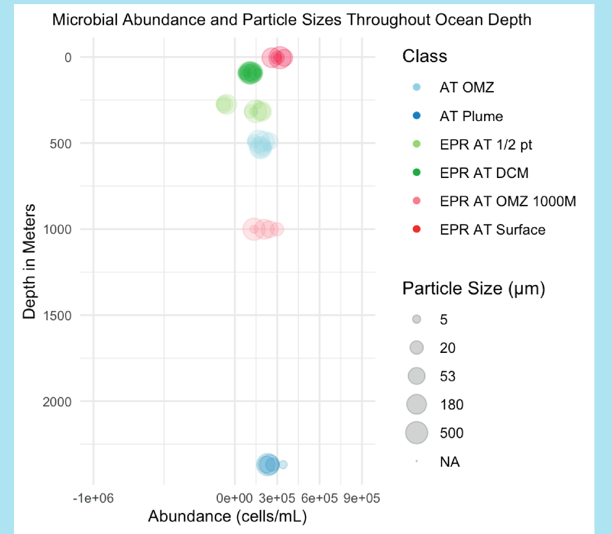
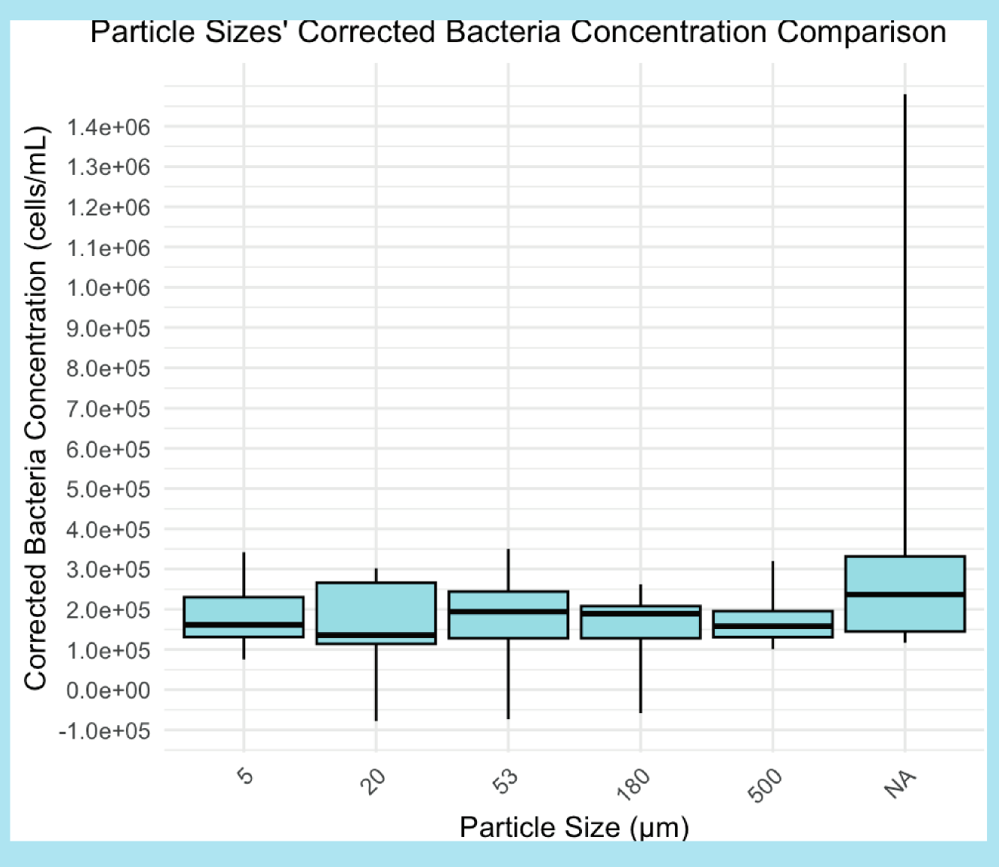

# Microbial Abundance on Marine Snow in the Deep Ocean

**NSF Research Experiences for Undergraduates (REU), Maryland Sea Grant (Horn Point Laboratory, University of Maryland Center for Environmental Science)** · Summer 2022, extended into a year-long Honors thesis at Gallaudet University (2022-2023)

**[Read the poster (PDF)](./REU-Marine-Snow-Poster-Thompson.pdf)**

## The question

Marine snow, the sinking flakes of organic debris in the ocean, carries carbon and microbes to deep water. Do bacteria on these particles become less abundant with depth, and are smaller particles more heavily colonized than larger ones?

## The data and what I did

- **Samples:** stored, frozen samples from a 2019 research cruise to the East Pacific Rise (AT42-09), covering depths from 4 m at the surface to 2,369 m in a hydrothermal plume. I processed and counted the samples; I did not collect them at sea.
- **Lab work:** processed and counted 63 sample tubes with DAPI staining and epifluorescence microscopy, and recorded the cell counts normalized to the volume filtered.
- **Data:** managed and analyzed the dataset in R and Excel, and corrected each count against negative controls.
- **Writing:** wrote the REU project proposal, then extended the summer project into an Honors thesis and this poster.

## What I found

<table>
<tr>
<td width="50%" valign="top"> Figure 3 from the poster: abundance by depth, colored by sampling site and sized by particle size</td>
<td width="50%" valign="top"> Figure 4 from the poster: corrected bacteria concentration by particle size</td>
</tr>
</table>

- **Particle size:** no correlation between particle size and microbial abundance. That contradicted the hypothesis that smaller particles carry more bacteria.
- **Depth:** abundance was highest near the surface and fell until about 300 m, then rose again at greater depths, where nutrients are scarcer.
- **The mismatch:** I flagged that the deep-ocean measurements did not match the conclusions of a published study (Bergauer et al. 2018), and named possible reagent contamination as one explanation.

## Limits, and what I would change

- Possible reagent contamination means the deep-water counts may be inflated.
- Particle sizes were not normalized for their logarithmic spacing, which may hide a size effect.
- The poster recommends stricter reagent cleaning, more replicates per sample and shorter analysis timeframes.

**Tools:** R · Excel · epifluorescence microscopy · DAPI staining
